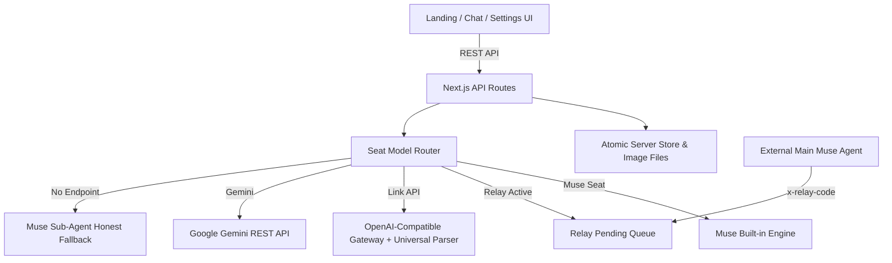

# Meja Bundar Implementation Plan

**Goal:** Build the fullstack **Meja Bundar** multi-AI group chat web application matching PRD Sections 1–13, verified end-to-end across backend tests, browser UI, and mobile viewports.

**Architecture:** Next.js App Router fullstack application (`src/app/`) with server-side persistent JSON storage (`data/meja-bundar.json`) protected by an async write mutex, server-side provider execution (Gateway OpenAI-compatible + SSE/JSON/text parser, Google Gemini API, Muse built-in/sub-agent engine, local image generation/saving), and 8-character single-use hashed Relay endpoints.

**Tech Stack:** Next.js 15 (App Router), React 19, TypeScript, Tailwind CSS v4, Vitest, Node 24.

## Global Constraints
- Default owner name derived from logged-in OS account (`Geiza Rhizaqi` on current host), editable in Settings; NEVER use `"Kamu"` for the owner.
- API keys (`gatewayApiKey`, `geminiApiKey`) and relay codes are NEVER returned plaintext after initial creation (keys always masked; relay codes SHA-256 hashed, 8 chars, single-use, 30-min expiry).
- Muse seat NEVER routes through owner's Gateway or Gemini and is NEVER labeled demo.
- Provider failures show real raw provider errors under the seat bubble without silent demo fallback.
- Every AI bubble displays an honest source label (`Muse bawaan`, `Muse bawaan (sub-agent)`, `via Gemini (login Google) · <model>`, `via Link API (gateway) · <model>`, or `via Relay — dijawab Muse utama (agen di chat utama)`).

## Tasks
- [ ] **Task 1: Project scaffold & TypeScript/Vitest setup** (`package.json`, `tsconfig.json`, `next.config.ts`, `.gitignore`, `src/app/layout.tsx`, `src/app/globals.css`, `public/avatars/*`).
- [ ] **Task 2: Domain types, personas, masking, and persistent server store** (`src/lib/types.ts`, `src/lib/personas.ts`, `src/lib/mask.ts`, `src/lib/store.ts` + Vitest unit tests).
- [ ] **Task 3: Universal Gateway response parser & provider clients** (`src/lib/parser.ts`, `src/lib/providers/gateway.ts`, `src/lib/providers/gemini.ts`, `src/lib/providers/muse.ts`, `src/lib/providers/image.ts` + Vitest tests covering SSE, `delta`, `content` string, `content` array of parts, plain JSON, plain text, and real error propagation).
- [ ] **Task 4: Chat orchestration engine & Relay service** (`src/lib/chat-engine.ts`, `src/lib/relay.ts` + Vitest tests for Diskusi Bergilir on/off, `@mention`, 6-stage `Tugas:` pipeline resilience, `Gambar:`, `Tanya Progres`, 40-msg context cap, and Relay 8-char single-use/30m expiry/10m timeout).
- [ ] **Task 5: API Routes** (`/api/settings`, `/api/messages`, `/api/chat/send`, `/api/chat/clear`, `/api/chat/progress`, `/api/providers/gateway/test`, `/api/providers/gemini/models`, `/api/relay/code`, `/api/relay/pending`, `/api/relay/answer`, `/api/relay/disable`, `/api/images/[filename]`).
- [ ] **Task 6: Landing Page (`/`)** adhering strictly to PRD Section 7 & `DESIGN.md` / `antislop` DURING rules.
- [ ] **Task 7: Chat Page (`/chat`) & Settings Panel** adhering strictly to PRD Sections 8, 9, 10 & `DESIGN.md` / `antislop` DURING rules.
- [ ] **Task 8: End-to-end verification** (Vitest suite, production `next build`, live server + real headless browser check across desktop 1440px & mobile 390px/320px for every item in PRD Section 12).
